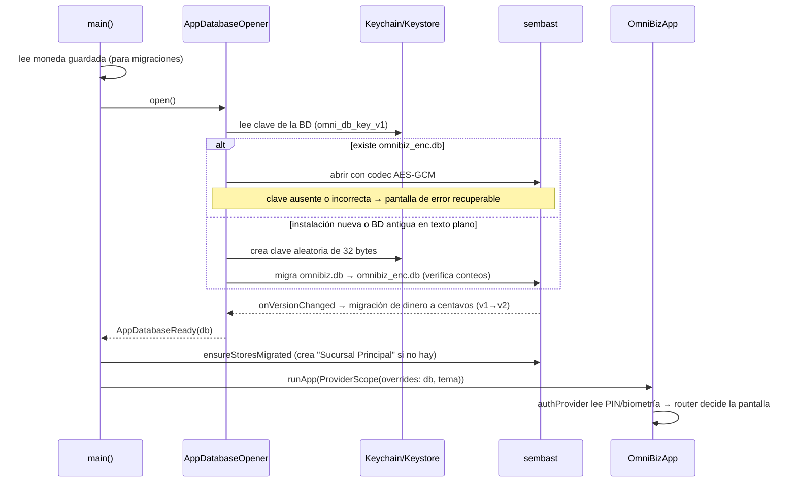
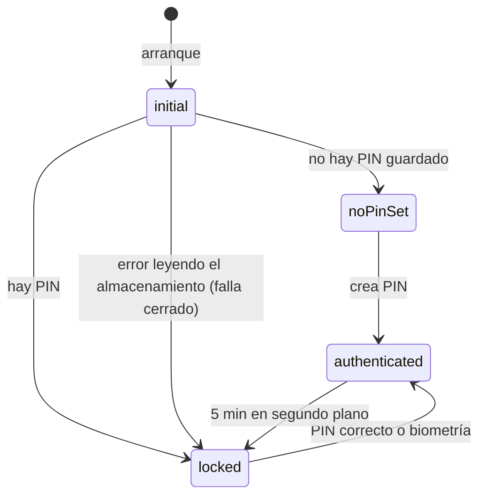
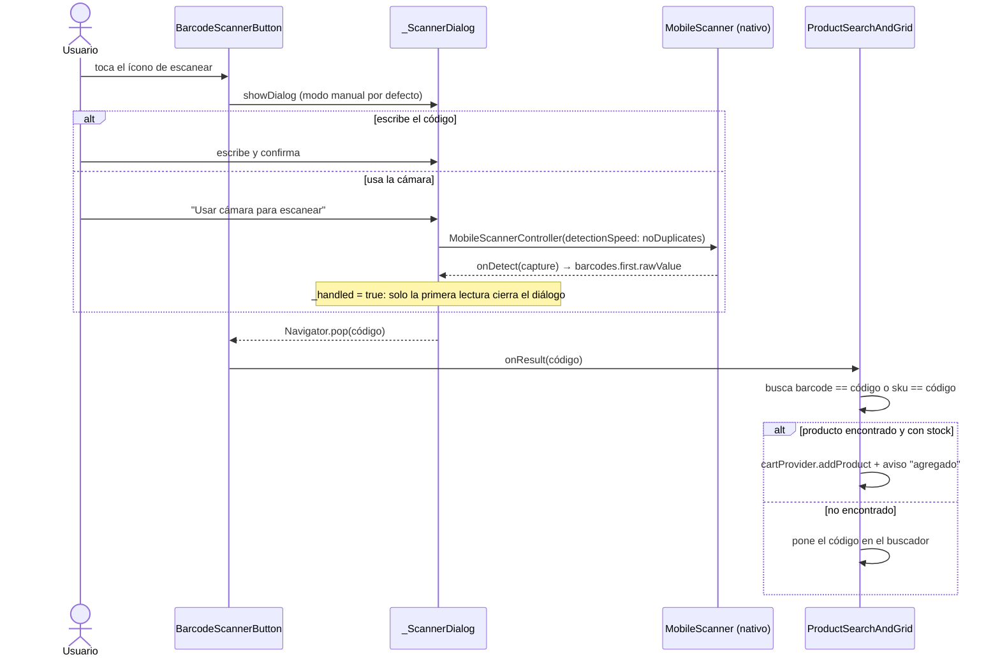
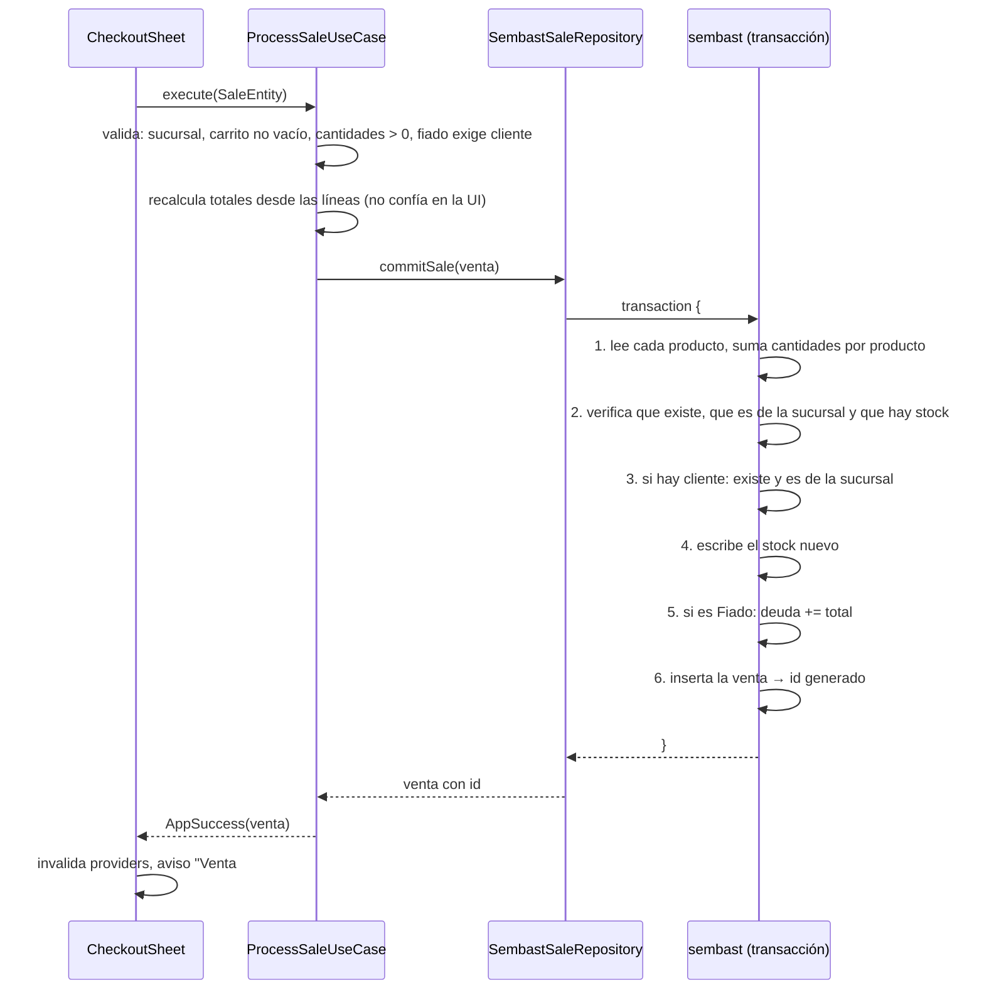

# OmniBiz: análisis técnico y funcional

> Análisis del código de `inventario_app` (OmniBiz), rama `feat/rediseno-dual-y-correcciones`,
> hecho leyendo el código fuente y el de sus dependencias clave, no la documentación.
> Fecha: 14 de octubre de 2026.

---

## Índice

1. [Resumen ejecutivo](#1-resumen-ejecutivo)
2. [Stack y dependencias](#2-stack-y-dependencias)
3. [Arquitectura](#3-arquitectura)
4. [Arranque de la app](#4-arranque-de-la-app)
5. [Persistencia: base de datos local cifrada](#5-persistencia-base-de-datos-local-cifrada)
6. [Dinero: montos exactos en centavos](#6-dinero-montos-exactos-en-centavos)
7. [Seguridad y autenticación](#7-seguridad-y-autenticación)
8. [Funcionalidades](#8-funcionalidades)
   - 8.1 [Onboarding y tipo de negocio](#81-onboarding-y-tipo-de-negocio)
   - 8.2 [Dashboard](#82-dashboard)
   - 8.3 [Inventario: productos y categorías](#83-inventario-productos-y-categorías)
   - 8.4 [Escáner de códigos QR y de barras](#84-escáner-de-códigos-qr-y-de-barras)
   - 8.5 [Punto de venta (POS)](#85-punto-de-venta-pos)
   - 8.6 [Checkout: la venta atómica](#86-checkout-la-venta-atómica)
   - 8.7 [Clientes y fiado](#87-clientes-y-fiado)
   - 8.8 [Recibos en PDF](#88-recibos-en-pdf)
   - 8.9 [Historial de ventas](#89-historial-de-ventas)
   - 8.10 [Análisis](#810-análisis)
   - 8.11 [Sucursales (multi-tienda)](#811-sucursales-multi-tienda)
   - 8.12 [Ajustes](#812-ajustes)
9. [Sistema de diseño](#9-sistema-de-diseño)
10. [Calidad y pruebas](#10-calidad-y-pruebas)
11. [Plataformas y compilación](#11-plataformas-y-compilación)
12. [Hallazgos y riesgos](#12-hallazgos-y-riesgos)
13. [Recomendaciones](#13-recomendaciones)

---

## 1. Resumen ejecutivo

OmniBiz es un **punto de venta (POS) con inventario, clientes a crédito ("fiado") y analítica**
para negocios pequeños (tiendas, restaurantes, otros locales). Es una app Flutter **100 %
offline y de un solo dispositivo**: no tiene backend, ni cuentas de usuario, ni sincronización.
Todos los datos viven en una base de datos local **cifrada** en el teléfono o tablet.

| Aspecto | Estado |
|---|---|
| Tamaño | 112 archivos Dart, ~13 600 líneas |
| Arquitectura | Clean Architecture por funcionalidad (domain → data → presentation) |
| Estado | Riverpod 2 (sin generación de código) |
| Datos | sembast (NoSQL en archivo) cifrado con AES-256-GCM |
| Seguridad de acceso | PIN con PBKDF2 + bloqueo progresivo + biometría |
| Pruebas | 177 tests, `flutter analyze` sin issues |
| Plataformas | Android (minSdk 24) e iOS; macOS/Linux/Windows sin probar |

**Lo más sólido:** la venta es atómica (todo o nada), el dinero es exacto (enteros en centavos), la
base de datos está cifrada con migraciones seguras y el PIN usa una derivación de claves real.

**Los riesgos más importantes** están en la [sección 12](#12-hallazgos-y-riesgos). El crítico es que
**no existe ningún respaldo ni exportación de datos**: perder el teléfono es perder el negocio.
Además, **la biometría no funciona en Android** y **Face ID no está declarado en iOS**.

---

## 2. Stack y dependencias

Versiones resueltas en `pubspec.lock`:

| Paquete | Versión | Para qué se usa |
|---|---|---|
| `flutter_riverpod` | 2.6.1 | Estado y dependencias (providers) |
| `go_router` | 14.8.1 | Navegación y protección de rutas |
| `sembast` | 3.8.11 | Base de datos NoSQL embebida (archivo) |
| `cryptography` | 2.9.0 | AES-256-GCM para cifrar la base de datos |
| `crypto` | 3.0.7 | SHA-256 / HMAC para el hash del PIN |
| `flutter_secure_storage` | 9.2.4 | Keychain (iOS) / Keystore (Android): PIN, clave de la BD, preferencias |
| `local_auth` | 2.3.0 | Huella / Face ID |
| `mobile_scanner` | 7.4.2 | Escáner de códigos QR y de barras con la cámara |
| `pdf` + `printing` | 3.13.1 / 5.15.1 | Generar el recibo y abrir la hoja de imprimir/compartir |
| `fl_chart` | 0.69.2 | Gráficas de ventas |
| `intl` | 0.20.3 | Formato de moneda y fechas |
| `path_provider` | 2.1.6 | Rutas de archivos del sistema |
| `lucide_icons_flutter` | 3.1.x | Íconos |

La tipografía **Outfit** va empaquetada en `assets/fonts/outfit/` (licencia OFL): la app no
descarga nada de internet.

---

## 3. Arquitectura

### 3.1 Estructura de carpetas

```
lib/
├── main.dart                  # Arranque: abre la BD cifrada y lanza la app
├── app/
│   ├── app.dart               # MaterialApp, temas, bloqueo por inactividad
│   └── router/                # go_router + guardia de autenticación
├── core/
│   ├── database/              # Apertura cifrada, codec AES-GCM, migraciones
│   ├── security/              # PBKDF2 para el PIN
│   ├── design_system/         # Tokens, tema claro/oscuro, componentes
│   ├── error/                 # Jerarquía Failure + mensajes para el usuario
│   ├── utils/                 # Money, formato, validadores, logger, constantes
│   └── receipt_service.dart   # Recibo PDF
├── shared/
│   ├── providers/             # BD, sucursal actual, moneda, tema, tipo de negocio
│   └── widgets/               # Escáner, gráfica de ventas
└── features/
    ├── auth/         ├── onboarding/   ├── dashboard/
    ├── inventory/    ├── sales/        ├── customers/
    ├── stores/       ├── analytics/    └── settings/
```

### 3.2 Capas por funcionalidad

Cada funcionalidad con datos sigue la misma forma:

```
domain/entities      → objetos puros de negocio (ProductEntity, SaleEntity...)
domain/repositories  → interfaces (contratos) — no saben nada de sembast
domain/usecases      → reglas de negocio con varios pasos (ProcessSaleUseCase)
data/models          → clases con toMap/fromMap escritas a mano (sin codegen)
data/mappers         → conversión modelo ↔ entidad
data/repositories    → implementación sembast de las interfaces
presentation/        → providers de Riverpod + pantallas
```

La inyección de dependencias está en `shared/providers/database_provider.dart`: el provider de la
base de datos se **sobrescribe en `main.dart`** con la instancia ya abierta, y cada repositorio se
construye a partir de ella. En los tests se sobrescriben con bases en memoria o con dobles.

### 3.3 Manejo de errores

- **`Failure`** (`core/error/failures.dart`): jerarquía sellada con `DatabaseFailure`,
  `ValidationFailure`, `NotFoundFailure` y `StockFailure`.
- **`AppResult<T>`** (`core/utils/app_result.dart`): los casos de uso devuelven `AppSuccess(data)` o
  `AppFailure(failure)` en lugar de lanzar excepciones. La UI decide con un `switch`.
- **`ErrorMapper`** traduce un `Failure` al texto que ve el usuario.
- **`AppLogger`** solo escribe en modo debug (`kDebugMode`). En producción no hay registro de errores
  ni reporte de fallos.

### 3.4 Estado (Riverpod)

| Provider | Tipo | Contenido |
|---|---|---|
| `databaseProvider` | `Provider` (sobrescrito en `main`) | Instancia sembast abierta |
| `authProvider` | `Notifier` | Estado de sesión: `initial / noPinSet / locked / authenticated` |
| `currentStoreProvider` | `Notifier` | Id de la sucursal activa (persistido) |
| `currencyProvider` | `Notifier` | COP o USD (persistido) |
| `themeModeProvider` | `Notifier` | Sistema / claro / oscuro (persistido) |
| `businessTypeProvider` | `Notifier` | `retail` / `fnb` / `generic` (persistido) |
| `productsProvider`, `categoriesProvider`, `customersProvider` | `AsyncNotifier` | Datos de la sucursal activa |
| `cartProvider` | `Notifier` | Carrito del POS + cliente seleccionado |
| `salesInRangeProvider` | `FutureProvider.family` | Ventas en un rango de fechas |
| `salesHistoryProvider` | `AsyncNotifier.family` | Historial paginado con filtros |

Casi todos los datos **dependen de `currentStoreProvider`** (`ref.watch`): al cambiar de sucursal se
recargan solos y el carrito se vacía.

---

## 4. Arranque de la app



Si la base de datos no se puede abrir, `main` no crea una vacía encima: muestra
`DatabaseErrorApp` con **Reintentar** o **Empezar de cero**. La segunda opción **no borra** el
archivo ilegible: lo renombra a `omnibiz_enc.db.unreadable-<timestamp>`.

**Bloqueo por inactividad** (`app/app.dart`): la app observa el ciclo de vida del sistema. Si pasó
**5 minutos o más** en segundo plano (`AppConstants.lockAfter`), al volver llama a
`authProvider.lock()` y el router manda a la pantalla de PIN.

---

## 5. Persistencia: base de datos local cifrada

### 5.1 sembast

sembast es una base de datos NoSQL que guarda **un archivo** en el directorio de documentos de la
app. Los datos se organizan en *stores* (como colecciones), cada registro tiene una clave entera
autoincremental y un mapa JSON como valor.

| Store | Contenido | Campos relevantes |
|---|---|---|
| `products` | Productos | `name`, `category` (texto), `price`/`costPrice` (centavos), `stock`, `sku`, `barcode`, `variants`, `storeId` |
| `categories` | Categorías | `name`, `icon`, `storeId` |
| `sales` | Ventas | `items[]` embebidos, `totalAmount`, `paymentMethod`, `currencyCode`, `customerId`, `createdAt` (ISO-8601), `storeId` |
| `customers` | Clientes | `name`, `phone`, `email`, `totalDebt` (centavos), `lastTransaction`, `storeId` |
| `stores` | Sucursales | `name`, `icon`, `address` |
| `app_meta` | Marcas internas | `money_minor_units` (migración aplicada) |

Todas las consultas filtran por `storeId`: cada sucursal ve solo sus datos.

### 5.2 Cifrado (AES-256-GCM)

Archivo: `core/database/database_encryption.dart`.

- sembast permite un **codec**: una función que transforma cada registro antes de escribirlo en
  disco y al leerlo. OmniBiz implementa uno con **AES-256-GCM** (librería `cryptography`).
- Cada registro se guarda como `base64(nonce[12 bytes] ‖ texto cifrado ‖ tag[16 bytes])`, con un
  **nonce aleatorio por registro**. Dos registros iguales producen textos cifrados distintos.
- GCM autentica los datos: con una clave equivocada la verificación falla y sembast lanza
  `invalidCodec`. Nunca se leen datos basura.
- **La clave**: 32 bytes de `Random.secure()`, en base64, en `flutter_secure_storage` bajo
  `omni_db_key_v1`. En iOS queda en el **Keychain** y en Android en el **Keystore**, ambos protegidos
  por el sistema operativo.
- Solo se crea una clave nueva cuando **no existe** un archivo cifrado. Así nunca se pierde el acceso
  a datos existentes por crear una clave encima.

### 5.3 Migraciones

| Migración | Archivo | Qué hace | Cuándo corre |
|---|---|---|---|
| Texto plano → cifrado | `app_database.dart` | Exporta `omnibiz.db`, importa en `omnibiz_enc.db.tmp` con el codec, **relee desde disco y compara conteos por store**, renombra atómicamente y borra el texto plano | Primera apertura tras actualizar |
| Dinero a centavos (v1 → v2) | `money_migration.dart` | Convierte todos los montos `double` a `int` en centavos (productos, clientes, ventas y sus líneas) y asigna `currencyCode` a ventas antiguas | `onVersionChanged` de sembast, dentro de la transacción de apertura |
| Sucursal por defecto | `store_migration.dart` | Si no hay sucursales crea "Sucursal Principal" y asigna su id a los registros sin `storeId` | En cada arranque (idempotente) |

Las tres son **idempotentes**: correrlas dos veces no cambia nada. La de dinero deja una marca en
`app_meta` y corre dentro de una transacción: si falla, ni los datos ni la versión cambian.

---

## 6. Dinero: montos exactos en centavos

Archivo: `core/utils/money.dart`.

Todos los montos son **`int` en centavos** con escala fija de 100 para cualquier moneda. Así la
aritmética es exacta: sin residuos de coma flotante ni deudas fantasma de `0,0000001`.

| Función | Ejemplo |
|---|---|
| `Money.parse("1500,5")` | `150050`. Acepta coma o punto y máximo dos decimales, sin separador de miles. |
| `Money.toInput(150050)` | `"1500.50"`, para precargar un campo |
| `Money.toMajor(150050)` | `1500.5`, **solo** para mostrar o graficar |
| `Money.fromDouble(10.005)` | `1001`. Redondea sobre la representación decimal del `double`, no sobre `x * 100` (que daría 1000). |

**Formato en pantalla** (`currency_formatter.dart`):

| Moneda | Formato | Ejemplo |
|---|---|---|
| COP | Símbolo adelante, punto de miles, sin decimales | `$4.500` |
| USD | Coma de miles, punto decimal | `$4,500.00` |
| Compacto | Para KPIs | `$613 mil` |

Cada venta guarda su `currencyCode`. Cambiar la moneda en Ajustes **no reetiqueta** las ventas
anteriores: el historial y los recibos muestran cada venta en la moneda en que se hizo. **No hay
conversión entre monedas** (ver hallazgos).

---

## 7. Seguridad y autenticación

### 7.1 Flujo



El **router** (`app_router.dart`) traduce cada estado en una pantalla obligatoria:

| Estado | Pantalla forzada |
|---|---|
| `initial` | `/splash`. Mientras se lee el almacenamiento seguro, **nada más es accesible**. |
| `noPinSet` | `/auth/setup` (crear PIN) |
| `locked` | `/auth` (pantalla de PIN) |
| `authenticated` | Si estaba en una pantalla de acceso, va al dashboard o al onboarding |

### 7.2 PIN

Archivo: `core/security/pin_hasher.dart`.

- **Algoritmo**: PBKDF2-HMAC-SHA256 (RFC 8018), **100 000 iteraciones**, sal aleatoria de 16 bytes,
  clave derivada de 32 bytes.
- **Formato guardado**: `pbkdf2_sha256$100000$<sal base64>$<hash base64>`, en el Keychain/Keystore
  bajo `omni_pin_hash`.
- El cálculo corre en un **isolate** (`Isolate.run`) para no congelar la interfaz: tarda unos
  265 ms en Apple Silicon y es lento a propósito, para encarecer los ataques de fuerza bruta.
- La comparación es en **tiempo constante**, así que no filtra información por tiempos de respuesta.
- **Migración automática**: reconoce el formato antiguo (SHA-256 sin sal, 64 caracteres
  hexadecimales). Si el PIN es correcto, lo vuelve a guardar en el formato nuevo.
- El PIN es de **4 dígitos**: 10 000 combinaciones posibles.

### 7.3 Bloqueo por intentos fallidos

`AuthNotifier.unlockWithPin` y `pinLockoutFor`:

| Fallos acumulados | Espera |
|---|---|
| 1 a 4 | Ninguna |
| 5 | 30 s |
| 6 | 60 s |
| 7 | 2 min |
| … | Se duplica |
| Tope | 1 hora |

El contador y la hora de desbloqueo se guardan en el almacenamiento seguro
(`omni_pin_failed_attempts`, `omni_pin_locked_until`): **reiniciar la app no reinicia el bloqueo**.
La pantalla muestra una cuenta regresiva y desactiva el teclado.

### 7.4 Biometría

`LocalAuthRepository.authenticateWithBiometrics` usa `local_auth` con `biometricOnly: false` y
`stickyAuth: true`. Una biometría válida desbloquea la app y también **borra el bloqueo por PIN**.

Hay tres problemas reales (detalle en [hallazgos](#12-hallazgos-y-riesgos)):

1. **Android: no funciona.** `local_auth` exige que la actividad sea `FragmentActivity` (lo comprueba
   en `LocalAuthPlugin.java:124`), pero `MainActivity` extiende `FlutterActivity`. El error se traga
   en un `catch` y la app se comporta como si el usuario hubiera cancelado.
2. **iOS: falta `NSFaceIDUsageDescription`** en `Info.plist`. Sin esa clave, Face ID no puede usarse
   en iPhones con Face ID.
3. Con `biometricOnly: false`, **el código de desbloqueo del teléfono también abre la app**. Si el
   negocio comparte el teléfono, quien lo desbloquee entra a OmniBiz sin saber el PIN.

### 7.5 PIN olvidado

`AuthNotifier.resetPin()` existe, pero **ninguna pantalla lo llama**. Si el usuario olvida el PIN y
no tiene biometría funcional, la única salida es desinstalar, y al desinstalar se pierde la clave de
cifrado y con ella todos los datos.

---

## 8. Funcionalidades

### 8.1 Onboarding y tipo de negocio

**Pantalla:** `features/onboarding/presentation/screens/onboarding_screen.dart`.

La primera vez, tras crear el PIN, el usuario elige el tipo de negocio:

| Opción | Valor guardado | Texto que promete la pantalla |
|---|---|---|
| Tienda de ropa / Retail | `retail` | "Gestión de tallas, colores y variantes de stock" |
| Restaurante / Bar | `fnb` | "Control de mesas, barra e ingredientes" |
| Otro local comercial | `generic` | "Puntos de venta rápidos y servicios" |

**Cómo funciona técnicamente:** el valor se guarda en el almacenamiento seguro
(`omni_business_type`) y viaja como parámetro de la URL (`/dashboard?type=fnb`). En el código solo
cambia **la etiqueta del dashboard y los accesos rápidos**, y cada venta guarda `businessContext`.

**No existen** mesas, barra, ingredientes, recetas ni manejo de tallas o colores en el POS. La
promesa de la pantalla no coincide con lo que hace la app (ver hallazgos).

### 8.2 Dashboard

**Pantalla:** `features/dashboard/presentation/screens/dashboard_screen.dart`.

Un provider derivado (`_dashboardStatsProvider`) calcula en memoria, a partir de los productos de
la sucursal y de las ventas de los **últimos 7 días calendario** (`salesInRangeProvider(lastDaysRange(7))`):

- **Ventas de hoy** (tarjeta principal) y su variación porcentual frente a ayer.
- Total y número de tickets de la semana, ticket promedio.
- Unidades en stock, productos por reponer (stock menor que 5) y agotados (stock 0 o menos).
- Gráfica de los 7 días (`shared/widgets/sales_chart.dart`, `fl_chart`).
- Accesos rápidos, lista de productos con poco stock e inventario con "Ver todo".
- En pantallas anchas se reparte en dos columnas.

Los rangos de fecha se calculan con límites en **medianoche**, así la clave del provider es
estable durante todo el día y no recarga en cada redibujado.

### 8.3 Inventario: productos y categorías

**Pantallas:** `add_product_screen.dart` (crear y editar) y `categories_screen.dart`.

**Producto** (`ProductEntity`):

| Campo | Detalle |
|---|---|
| `name`, `category` | La categoría se guarda **como texto**, no como referencia a la categoría |
| `price`, `costPrice` | Centavos. El formulario muestra utilidad y margen en vivo. |
| `stock` | Entero |
| `sku` | Se **genera automáticamente** al crear: `SKU-<milisegundos>` |
| `barcode` | Opcional. Se escribe a mano o se **escanea** (ver 8.4). |
| `variants` | Lista de textos libres (p. ej. "M", "Rojo") |

Reglas derivadas: `isLowStock` (stock menor que 5), `isOutOfStock` (stock 0 o menos), `margin` y
`profit`.

**Cómo guarda:** `SembastProductRepository.save` hace `add` si el id es 0, o `put` (reemplazo
completo) si se está editando, dentro de una transacción.

**Categorías:** nombre e ícono por sucursal. Al **renombrar** o **eliminar** una categoría, los
productos **conservan el nombre viejo como texto**: el diálogo dice "Los productos quedarán sin
categoría", pero no es así (ver hallazgos).

### 8.4 Escáner de códigos QR y de barras

**Archivo:** `lib/shared/widgets/barcode_scanner_button.dart`. Se usa en dos lugares:

| Dónde | Qué pasa con el código leído |
|---|---|
| **Buscador del POS** (`product_grid.dart`) | Busca un producto cuyo `barcode` **o** `sku` sea **exactamente** igual. Si existe y hay stock, lo agrega al carrito y muestra "*Producto* agregado". Si no, deja el código en el buscador para filtrar. |
| **Formulario de producto** (`add_product_screen.dart`) | Escribe el código leído en el campo "Código de barras" |

#### Motor de lectura

Usa **`mobile_scanner` 7.4.2**, que no implementa la lectura: delega en el motor nativo de cada
plataforma.

| Plataforma | Motor | Detalle |
|---|---|---|
| Android | **Google ML Kit** Barcode Scanning (`com.google.mlkit:barcode-scanning:17.3.0`) | Modelo **empaquetado dentro del APK**: funciona **sin internet** y sin Google Play Services. Suma unos MB al APK. Se puede cambiar a la versión no empaquetada con la propiedad Gradle `dev.steenbakker.mobile_scanner.useUnbundled`. |
| iOS / macOS | **Apple Vision** + AVFoundation | Framework del sistema, sin dependencias extra |

**Formatos:** el controlador se crea sin la lista `formats` (vacía por defecto), lo que significa
**todos los formatos que soporte el motor**:

- **2D:** QR, Data Matrix, PDF417, Aztec.
- **1D:** EAN-13, EAN-8, UPC-A, UPC-E, Code 128, Code 39, Code 93, Codabar, ITF.

En la práctica, el mismo botón lee el **código de barras impreso en un producto** (EAN-13 en casi
todo lo de supermercado) y un **código QR**.

#### Flujo paso a paso



#### Detalles técnicos

1. **Entrada manual primero.** El diálogo abre en modo manual con el teclado activo. Sirve para
   escribir el código y para **lectores de código de barras USB o Bluetooth**, que se comportan
   como un teclado: "escriben" el código y envían Enter, y `onSubmitted` lo confirma.
2. **La cámara solo se enciende al pedirla.** El `MobileScannerController` se crea al tocar "Usar
   cámara para escanear" y se destruye (`dispose`) al cerrar el diálogo.
3. **`DetectionSpeed.noDuplicates`:** la cámara analiza muchos fotogramas por segundo. Con este modo
   el plugin no repite un código que ya entregó, y el tiempo de espera entre detecciones queda en 0.
4. **Guardia `_handled`:** aun así, `onDetect` puede llegar varias veces antes de que el diálogo se
   cierre. Sin la guardia, un segundo `Navigator.pop` cerraba también la pantalla del POS que estaba
   detrás. Ahora la primera lectura gana, se detiene la cámara (`stop()`) y se cierra el diálogo una
   sola vez. Hay un test (`test/shared/barcode_scanner_button_test.dart`) que lo comprueba.
5. **Retícula:** un rectángulo dibujado sobre la vista previa (65 % × 55 %) como guía visual. **No
   limita** el área de lectura: el motor analiza el fotograma completo.
6. **Errores de cámara** (`errorBuilder`): permiso denegado ("Actívalo en Ajustes > Privacidad >
   Cámara"), dispositivo sin cámara, u otro error. En todos los casos el diálogo vuelve al modo manual
   con un aviso.
7. **Permisos:**
   - Android: `CAMERA` lo declara el propio plugin en su manifiesto y se fusiona al compilar. Se pide
     en tiempo de ejecución la primera vez.
   - iOS: `NSCameraUsageDescription` en `Info.plist` ("Se necesita la cámara para escanear códigos
     de barras de productos").
8. **Qué se lee:** `rawValue`, el texto crudo del código. Si un QR contiene una URL, un texto o un
   JSON, se trata igual: como una cadena que se compara contra `barcode` y `sku`. **No se interpreta**
   el contenido: no hay QR de pago, ni de factura, ni con cantidades.

#### Limitaciones del escáner

- La búsqueda es por **igualdad exacta** (ignorando espacios al inicio y al final en la entrada
  manual). Un código con ceros a la izquierda distintos (`0123` frente a `123`) no coincide.
- **No hay unicidad** de `barcode` ni de `sku`. Si dos productos comparten código, se agrega el
  primero que aparezca.
- Un producto agotado escaneado **no se agrega** y solo filtra el buscador, sin un mensaje que diga
  "agotado".
- Cada escaneo agrega **1 unidad**. Para más, se toca el producto de nuevo o se usa el diálogo de
  cantidad.

### 8.5 Punto de venta (POS)

**Pantallas:** `pos_screen.dart` y los widgets de `pos/widgets/`.

- **Catálogo** (`product_grid.dart`): chips de categoría con conteo, buscador por nombre, código o SKU,
  y grilla responsive. Cada tarjeta muestra precio, stock y cuántas unidades ya hay en la orden.
- **Carrito** (`cart_notifier.dart`, estado `PosSessionState`):
  - Agregar 1 unidad (tocar), N unidades de una vez (`quantity_dialog.dart`), aumentar, disminuir,
    fijar la cantidad exacta, quitar (deslizando) o vaciar (pide confirmación).
  - Las líneas se **agrupan por producto**: tocar dos veces el mismo suma la cantidad.
  - El carrito **pertenece a la sucursal**: hace `ref.watch(currentStoreProvider)`, así que se vacía al
    cambiar de sucursal.
  - El carrito **no limita la cantidad al stock**. La validación ocurre al cobrar (ver 8.6).
  - Las **variantes no se pueden elegir** en el POS: el carrito siempre las guarda vacías.
- **Cliente** (`customer_selector.dart`): opcional. Muestra la deuda de cada cliente y agrega buscador
  si hay más de 5.
- **Distribución:** en tablet, el carrito va en un panel lateral. En teléfono, una barra inferior con
  el total y el botón **Cobrar**.

### 8.6 Checkout: la venta atómica

**Archivos:** `checkout_sheet.dart`, `process_sale_usecase.dart` y
`sembast_sale_repository.dart` (método `commitSale`).

**Métodos de pago** (`PaymentMethods`): `Efectivo`, `Tarjeta` y `Fiado`. Fiado solo se habilita con un
cliente seleccionado. Si se quita el cliente, el método vuelve a Efectivo.



**Por qué es atómica:** todo ocurre en **una sola transacción** de sembast. Si cualquier paso falla
(stock insuficiente, producto borrado, cliente de otra sucursal), se lanza una `SaleRejection`
**dentro** de la transacción y sembast deshace todo: no queda stock descontado sin venta ni venta
sin descuento de stock. Las transacciones de sembast se ejecutan en serie, así que dos ventas no
pueden leer el mismo stock a la vez.

Traducción de errores: `InsufficientStockRejection` → `StockFailure`,
`ProductNotFoundRejection` → `NotFoundFailure`, `InvalidSaleRejection` → `ValidationFailure`.

**Impuestos y descuentos:** la venta tiene `taxAmount` y `discountAmount`, pero el checkout **siempre
los manda en 0**. No hay IVA, propinas ni descuentos.

Tras una venta exitosa, el POS **sigue abierto** para la siguiente: solo se cierran las hojas
abiertas.

### 8.7 Clientes y fiado

**Pantalla:** `customers_screen.dart`. **Repositorio:** `sembast_customer_repository.dart`.

- Cliente: nombre, teléfono, email, `totalDebt` (centavos) y `lastTransaction`.
- **Venta a crédito:** el `commitSale` suma el total a `totalDebt` en la misma transacción de la
  venta.
- **Abono** (`registerPayment`): en una transacción, rechaza montos menores o iguales a 0 o mayores
  que la deuda, resta en centavos exactos y actualiza `lastTransaction`. El diálogo evita el doble
  envío.
- Insignias "Debe $…" / "Al día".

**Limitaciones:**

- **No hay historial de abonos.** Solo se guarda la deuda actual. No se puede ver cuándo ni cuánto
  pagó un cliente.
- **Se puede eliminar un cliente que debe dinero.** La confirmación no menciona la deuda y esa cuenta
  por cobrar se pierde (ver hallazgos).

### 8.8 Recibos en PDF

**Archivo:** `core/receipt_service.dart`.

- Tras cada venta se genera un PDF tamaño **rollo de 80 mm** (`PdfPageFormat.roll80`) con fecha,
  número de ticket, método de pago, moneda, líneas (cantidad × producto, total) y total.
- Se guarda una copia:
  - Android: en el almacenamiento externo propio de la app (`Android/data/com.omnibiz.pos/files/OmniBiz/`).
  - iOS: en Documentos.
- Después se abre la **hoja nativa de imprimir/compartir** (`Printing.layoutPdf`): impresora (AirPrint
  o Android Print), WhatsApp, correo, guardar en archivos.
- Desde el historial se puede **reabrir** el recibo de una venta pasada sin duplicar el archivo.

**Limitaciones:**

- El encabezado dice "OMNIBIZ AUTOMATION", no el nombre del negocio, su NIT ni su dirección.
- Es un **comprobante, no una factura electrónica** (DIAN): no tiene numeración autorizada, CUFE ni
  discriminación de impuestos.
- En Android la copia queda **sin cifrar** en almacenamiento accesible con un administrador de archivos,
  aunque la base de datos sí esté cifrada.
- La hoja de imprimir/compartir se abre **en cada venta**, aunque el cliente no quiera recibo.

### 8.9 Historial de ventas

**Pantalla:** `sales_history_screen.dart`. **Provider:** `salesHistoryProvider`.

- **Paginación por cursor:** carga 50 ventas (`AppConstants.listPageSize`) y "Cargar más" pide las
  siguientes con `createdAt` menor que la última cargada. No carga todo el historial en memoria.
- **Filtros** por periodo y por método de pago, aplicados **en la consulta** a la base de datos, no
  en memoria.
- Encabezados por día, etiquetas de método de pago y hoja de detalle con opción de recibo.
- `createdAt` se guarda como texto ISO-8601 **en hora local**: ordenar el texto equivale a ordenar
  por fecha mientras el dispositivo no cambie de zona horaria.

### 8.10 Análisis

**Pantalla:** `analytics_screen.dart`.

Calculado en memoria sobre las ventas de los **últimos 30 días** y los clientes:

- Ventas de hoy, de la semana y del mes, y ticket promedio.
- **Top 5 de productos** por cantidad vendida, con ingresos y barras.
- **Cuentas por cobrar:** total adeudado, número de clientes con saldo y los 5 mayores deudores.
- Estados de carga (esqueletos) y de error con reintento.

**Limitación:** si hay ventas en COP y en USD, los totales **se suman como si fueran la misma moneda**.

### 8.11 Sucursales (multi-tienda)

**Pantalla:** `stores_screen.dart`.

- Cada producto, categoría, venta y cliente tiene `storeId`, y todas las consultas filtran por la
  sucursal activa.
- La sucursal activa se persiste (`omni_current_store_id`). Si no hay ninguna guardada, se usa la
  primera.
- **Borrar una sucursal** se bloquea (`StoreInUseException`) si tiene productos, ventas o clientes, y
  la pantalla dice cuántos de cada uno. Si está vacía, se borra junto con sus categorías. Si era la
  activa, se activa otra.
- Los formularios no permiten guardar hasta que la sucursal activa esté cargada: nunca se escribe
  `storeId = 0`.

Las sucursales viven **en el mismo dispositivo**: no hay sincronización entre teléfonos de distintas
sucursales.

### 8.12 Ajustes

**Pantalla:** `settings_screen.dart`.

| Ajuste | Cómo se guarda | Efecto |
|---|---|---|
| Tema (Sistema / Claro / Oscuro) | `omni_theme_mode` | Se lee en `main` antes de `runApp` para no parpadear; transición animada |
| Moneda (COP / USD) | `app_currency` | Pide confirmación y advierte que no se convierten montos |
| Sucursal activa | `omni_current_store_id` | Recarga todos los datos |

Todas las preferencias se guardan en el almacenamiento seguro. **No hay** opciones para cambiar el
PIN, activar o desactivar la biometría, configurar los datos del negocio para el recibo, ni
exportar o respaldar datos.

---

## 9. Sistema de diseño

**Carpeta:** `lib/core/design_system/` (importar siempre `design_system.dart`).

- **Colores:** `OmniPalette` es un `ThemeExtension` con instancias `light` y `dark`, y se lee con
  `context.colors`. Es el único lugar con valores de color. El contraste está verificado:
  - Texto principal 7:1 o más.
  - Texto secundario y colores semánticos AA sobre sus fondos tintados.
  - Blanco sobre la marca unos 4,9:1.
- **Marca:** violeta-índigo `#5B5BF7` con degradado hacia `#8B5CF6`, usado solo en "Cobrar", "Nueva
  venta" y el KPI principal.
- **Tipografía:** `context.text.*` sobre Outfit empaquetada. Montos y cantidades con **dígitos
  tabulares**, para que las cifras no se muevan al cambiar.
- **Tokens:** `OmniSpacing`, `OmniRadius`, `OmniSizes`, `OmniBreakpoints`, `OmniMotion`.
- **Componentes:**

  | Tipo | Componentes |
  |---|---|
  | Átomos | `OmniButton` (con variante degradado), `OmniTextField`, `OmniBadge`, `OmniTag`, `OmniAvatar`, chips, `OmniSkeleton` (una sola animación compartida), `OmniPressable` |
  | Moléculas | `OmniCard`, `OmniSearchBar`, `OmniStatCard`, `OmniEmptyState`, `OmniErrorState`, `OmniConfirmDialog`, `OmniDialog`, `OmniBanner`, `showOmniSheet`, avisos `showOmni(mensaje, tone:)` |

- **Tema:** `omni_theme.dart` tematiza todos los componentes de Material (tarjetas, campos, botones,
  diálogos, hojas inferiores, navegación, transiciones de página).

---

## 10. Calidad y pruebas

`flutter analyze` sin issues. **177 tests** pasando:

| Área | Archivos de test |
|---|---|
| Base de datos | `app_database_test` (cifrado ida y vuelta, migración texto plano → cifrado, clave perdida o incorrecta, reinicio), `money_migration_test` |
| Seguridad | `pin_hasher_test` (vectores de prueba de PBKDF2), `local_auth_repository_test`, `auth_notifier_test` (bloqueo, splash del router) |
| Dinero y formato | `money_test`, `currency_formatter_test`, `date_formatter_test`, `form_validators_test` |
| Ventas | `process_sale_usecase_test` (venta atómica, rollback, fiado), `sembast_sale_repository_test` (rangos semiabiertos, paginación), `sales_providers_test`, `cart_notifier_test`, `sale_entity_test` |
| Inventario y clientes | `product_entity_test`, `sembast_product_repository_test`, `customer_entity_test`, `sembast_customer_repository_test` (abonos exactos) |
| Sucursales | `sembast_store_repository_test` (bloqueo de borrado) |
| Escáner | `barcode_scanner_button_test` (una lectura = un solo cierre) |

**Sin cubrir:** las pantallas completas con interacción (checkout de punta a punta en la UI), el
recibo PDF, la cámara real y la biometría real. Esas partes solo se validan probando en un
dispositivo.

---

## 11. Plataformas y compilación

| | Android | iOS |
|---|---|---|
| Identificador | `com.omnibiz.pos` | `com.omnibiz.pos` |
| Nombre visible | OmniBiz | OmniBiz |
| Mínimo | minSdk 24 (Android 7.0) | Lo que fije el proyecto Xcode |
| Respaldo del sistema | **Desactivado** (`allowBackup="false"`) | Por defecto de iOS |
| Firma de release | `android/key.properties` (fuera de git). Si falta, firma con la clave de debug y avisa. | Equipo de desarrollo en Xcode |
| Plugin de Android Gradle | 8.9.1 (requerido por `mobile_scanner`) | No aplica |

Para crear el keystore de release, ver la sección *App identity & release signing* del
`CLAUDE.md`.

---

## 12. Hallazgos y riesgos

Ordenados por impacto en el negocio.

### Crítico

| # | Hallazgo | Por qué importa | Dónde |
|---|---|---|---|
| C1 | **No hay respaldo ni exportación de datos de ningún tipo** | Todo vive en un solo teléfono, cifrado con una clave del Keychain/Keystore, y el respaldo de Android está desactivado. Si el teléfono se pierde, se daña o se desinstala la app, se pierden ventas, inventario y deudas, **sin forma de recuperarlos**. | Toda la app; `AndroidManifest.xml` |

### Alto

| # | Hallazgo | Por qué importa | Dónde |
|---|---|---|---|
| A1 | **La biometría no funciona en Android** | `local_auth` exige `FragmentActivity` y `MainActivity` extiende `FlutterActivity`. El error se ignora en silencio: el botón de huella no hace nada. | `MainActivity.kt`; `local_auth_repository.dart` |
| A2 | **Falta `NSFaceIDUsageDescription` en iOS** | Face ID no puede usarse en iPhones con Face ID; según la documentación de `local_auth` la clave es obligatoria. | `ios/Runner/Info.plist` |
| A3 | **PIN olvidado = datos perdidos** | `resetPin()` no es accesible desde ninguna pantalla. Sin biometría funcional (A1, A2), olvidar el PIN obliga a desinstalar, y con ello se pierde la clave de cifrado. | `auth_notifier.dart` |
| A4 | **Se puede borrar un cliente que debe dinero** | La cuenta por cobrar desaparece sin aviso ni rastro. | `customers_screen.dart`; `sembast_customer_repository.dart` |

### Medio

| # | Hallazgo | Dónde |
|---|---|---|
| M1 | El onboarding promete funciones que no existen (mesas, barra, ingredientes, tallas y colores) | `onboarding_screen.dart` |
| M2 | Las variantes se registran en el producto pero no se pueden elegir al vender | `cart_notifier.dart`; POS |
| M3 | Las categorías se guardan como texto en el producto: renombrar o borrar una categoría deja los productos con el nombre viejo, y el diálogo de borrado dice lo contrario | `categories_screen.dart`; `product_entity.dart` |
| M4 | Editar un producto reemplaza el stock con lo que diga el formulario, sin registro de movimientos ni motivo (ajuste, merma, compra) | `add_product_screen.dart` |
| M5 | No hay historial de abonos de clientes | `sembast_customer_repository.dart` |
| M6 | Los totales del dashboard y del análisis suman COP y USD como si fueran la misma moneda | `dashboard_screen.dart`; `analytics_screen.dart` |
| M7 | Con `biometricOnly: false`, el código de desbloqueo del teléfono también abre la app | `local_auth_repository.dart` |
| M8 | Los recibos en Android se guardan sin cifrar en almacenamiento accesible | `receipt_service.dart` |
| M9 | El recibo no lleva datos del negocio y no es factura electrónica; no hay IVA ni descuentos | `receipt_service.dart`; `checkout_sheet.dart` |
| M10 | `barcode` y `sku` no son únicos: un código repetido agrega el primer producto que aparezca | `add_product_screen.dart`; `product_grid.dart` |

### Bajo

| # | Hallazgo | Dónde |
|---|---|---|
| B1 | En producción no hay registro de errores ni reporte de fallos (`AppLogger` solo en debug) | `app_logger.dart` |
| B2 | La hoja de imprimir/compartir se abre en cada venta, aunque no se quiera recibo | `checkout_sheet.dart` |
| B3 | Escanear un producto agotado solo filtra el buscador, sin decir "agotado" | `product_grid.dart` |
| B4 | `createdAt` en hora local sin zona: si el dispositivo cambia de zona horaria, el orden del historial puede quedar desordenado en el borde | `sale_model.dart` |
| B5 | La paginación usa `createdAt` como cursor: dos ventas con el mismo instante exacto podrían saltarse una (muy improbable) | `sembast_sale_repository.dart` |
| B6 | PIN de solo 4 dígitos: el bloqueo progresivo lo protege bien, pero 6 dígitos sería más robusto | `lock_screen.dart` |

---

## 13. Recomendaciones

En orden sugerido.

1. **Respaldo y exportación (C1).** Exportar un archivo de respaldo cifrado con una contraseña que
   elija el usuario, compartible por la hoja nativa (Drive, correo, WhatsApp), y su importación.
   Opcional: exportar ventas e inventario a CSV.
2. **Arreglar la biometría (A1, A2).** Cambiar `MainActivity` a `FlutterFragmentActivity` y agregar
   `NSFaceIDUsageDescription` al `Info.plist`. Son dos cambios de una línea; luego probar en un
   dispositivo real.
3. **Recuperación del PIN (A3).** Combinada con el respaldo: "Olvidé mi PIN" restaura desde un
   respaldo, o pregunta de recuperación. Agregar también "Cambiar PIN" en Ajustes.
4. **Proteger las deudas (A4, M5).** Bloquear el borrado de clientes con saldo (o pedir confirmación
   explícita mostrando el monto) y guardar un historial de abonos.
5. **Alinear el onboarding con la realidad (M1, M2).** Ajustar los textos o implementar la selección
   de variantes en el POS.
6. **Categorías por id y movimientos de stock (M3, M4).** Referenciar la categoría por id, con
   migración, y registrar los ajustes de stock con motivo.
7. **Datos del negocio en el recibo y opción de no imprimir (M9, B2).**
8. **Monitoreo de errores en producción (B1),** por ejemplo Sentry, como en Lavadero.
9. **Unicidad de códigos (M10)** y aviso de "agotado" al escanear (B3).
